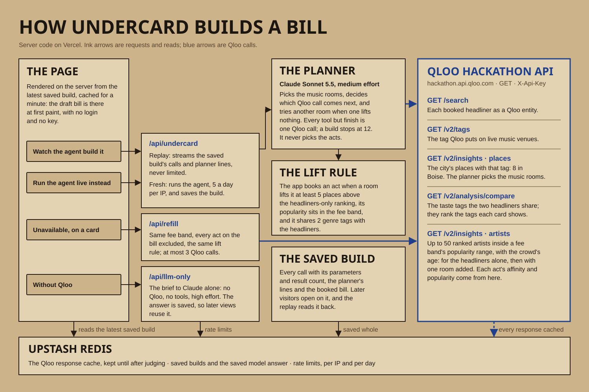

# Undercard

This repository's history is filtered from Undercard's private development repository: the same commits, with their dates and messages, with some files and quotes removed and data from Qloo's answers redacted, as Qloo's developer guide requires.

[](https://github.com/danielbutnar/undercard/actions/workflows/gate.yml)

A festival talent buyer fills the undercard from acts the town's own venue crowds favour,
inside the buyer's fee bands, and refills a slot when an act drops out; Undercard finds each
act through Qloo and shows why.

**Live demo: https://undercard-daniel-51ed.vercel.app** (no login, no API key).

Entry for the [Qloo Agentic Hackathon](https://qloo.devpost.com/). The brief is in
[SPEC.md](SPEC.md) and the event rules in [RULES.md](RULES.md).

## What it does

A talent buyer has booked a festival's headliners and set fee bands for the rest of the bill.
Undercard fills those slots with acts the town's own music crowd already follows, and says
why for each one.

The demo festival is Sagebrush Sound: fictional, 3,000 capacity, in Boise, Idaho, with
Khruangbin and Japanese Breakfast booked and two fee bands, Mid (4 slots) and Opener (6 slots).

1. The page opens on the saved build as the buyer's draft bill: the headliners over 4 Mid and
   6 Opener acts, each marked with the Boise room whose crowd lifted it in Qloo's ranking and
   how far ("new" when it entered the top 50). A rail counts what each tested room lifted, a zero included.
2. **Watch the agent build it**: the trace panel replays every Qloo call the agent made, with
   its parameters and result count, and the bill reprints. **Run the agent live instead**
   runs a fresh build.
3. Click an act to open its card: Qloo affinity, its popularity percentile inside the band,
   a "Why Boise" line naming the local venue whose fans lift it, and two Qloo tags it shares
   with the headliners.
4. Mark it **Unavailable** and say why: a radius clause, routing or the fee. Undercard finds a
   replacement in the same fee band with a new Qloo call, the replacement prints into the slot,
   and the reason names the refill's line in the trace.
5. Flip to **Without Qloo: the model's picks** to see the same brief answered by the model
   alone, each pick with the model's reason, no Boise room and no fee band check. **Export
   CSV** in the bar downloads the booking sheet; a replacement's row names the act it
   replaced and why.

Beyond the demo path, one click from the bill:

- **Same brief, other towns.** The town switcher links Austin, Denver and Nashville: the same
  headliners, capacity, crowd and fee bands, each drafted from that town's own rooms, saved and
  replayed like Boise's.
- **Your festival** (`/your-festival`). Name a town and two headliners, and the agent runs live
  for them with Sagebrush Sound's crowd and fee bands. It counts against the same per-IP limit
  as a fresh build, and nothing is saved. A headliner Qloo can't find, a town with too few
  music rooms and the daily limit each have their own designed state. A link can fill the form
  in: `/your-festival?town=Tallinn&headliner=Khruangbin&headliner=Japanese%20Breakfast`. It never
  runs on load, because mail clients and link previews open links by themselves.

## How it works



- **The agent plans the Qloo calls.** Claude Sonnet 5.5 works through tools that each make one Qloo call, plus one to finish
  ([src/server/agent.ts](src/server/agent.ts), [src/server/agent-tools.ts](src/server/agent-tools.ts)).
  It resolves the headliners, finds the city's live music venues and picks the music rooms
  among them as anchors, gets the taste the headliners share, then asks for each band's
  artists for the headliners alone, then once more for each anchor venue. It
  runs independent calls in parallel and stops at 12. In live builds it has changed course
  mid-build: when one anchor venue lifted no acts, it spent its last call on another room.
- **The app books the acts.** [src/lib/assemble-lineup.ts](src/lib/assemble-lineup.ts) takes
  an act when an anchor venue lifts it at least five places above the headliners-only
  ranking, its popularity sits inside the band, and it shares two genre tags with the
  headliners; each band takes its strongest-affinity acts. Every number on a card is Qloo's.
- **A refill** ([src/server/refill.ts](src/server/refill.ts)) reruns the venue query for that
  band with every act on the board excluded, in at most 3 calls, and applies the same bar.
- **Saved builds.** A complete build is saved ([src/server/build-store.ts](src/server/build-store.ts))
  and replayed to later visitors; the trace says when a board is a replay.
- **The first screen** ([src/app/page.tsx](src/app/page.tsx)) reads the latest saved build on
  the server and caches it for a minute, so the page is static HTML with the whole bill on
  first paint. With no saved build, or no answer from the store within 2 seconds, it falls
  back to the empty board and Build undercard. Each act's mark is read from its Why Boise line
  ([src/lib/marks.ts](src/lib/marks.ts)), so older saved builds need no new field.
- **Checks.** Unit tests in [tests/unit](tests/unit) run against a synthetic Qloo: each tool's
  query parameters, the 12-call cap, the refill's exclusions and 3-call cap, the rate limits.
  The demo path in [tests/e2e/demo-path.spec.ts](tests/e2e/demo-path.spec.ts) (all five steps,
  plus a first-paint check) passes against the live demo, most recently on 2026-10-17.
  GitHub Actions runs `pnpm gate` on every push to main and on pull requests.

## Sponsor technology

Qloo does the work in every build. The agent calls the Qloo hackathon API
(`https://hackathon.api.qloo.com`, `X-Api-Key`, GET only) at most 12 times per build, and
the trace panel lists every call with its parameters and result count.

| Endpoint | Why the agent calls it |
|---|---|
| `GET /search` | Resolve each booked headliner (names only in the seed) to a Qloo entity. |
| `GET /v2/tags` | Find the tag Qloo puts on live music venues. |
| `GET /v2/insights` with `filter.type=urn:entity:place` | List the festival city's places with that tag; the agent picks music rooms as anchor venues. |
| `GET /v2/analysis/compare` | Find the taste tags the two headliners share; they rank the two tags each card shows. |
| `GET /v2/insights` with `filter.type=urn:entity:artist` | Rank artists inside each fee band's popularity range (`filter.popularity.min/max`), first for the headliners alone, then for the headliners plus one anchor venue in `signal.interests.entities`. |

Qloo's artist type takes no location parameter, so local taste enters only through the
city's venues as signals. An act makes the board when an anchor venue lifts it at least five
places above the headliners-only ranking; its "Why Boise" line says by how much. Affinity,
popularity percentile, fee band, anchor venue and shared tags on every card come from those
responses.

The spike ([docs/qloo-spike.md](docs/qloo-spike.md)) checked that a venue is a real signal.
Adding Venue 227 to the headliners moved N–29 artists per fee band up five or more places,
and 22–23 of them share at least two genre tags with the headliners. The Visual Arts
Collective moved N–31 (21–23 with shared tags). Venue 166 Boise changed nothing, which
is why the agent measures each venue's lift instead of trusting the venue list.

Marking an act **Unavailable** refills its slot with at most 3 more Qloo calls: artist
insights for the same fee band, seeded by the headliners and the act's anchor venue (then the
build's other anchors), with the headliners and every act on the board in
`filter.exclude.entities`. The first act that venue lifts past the same bar takes the slot,
and the call appears in the trace.

**Without Qloo: the model's picks** sends the same festival brief to the model with no Qloo
and no tools, for comparison: each pick shows the model's own reason, with no Boise room behind
it and no popularity to check it against a fee band.

Qloo responses are cached server-side in Upstash Redis until at least 2026-11-18, past the end
of judging, and never committed. A complete build is saved the same way, so the next visitor
opens on it and "Watch the agent build it" replays its calls in 2 to 3 seconds, marked as a
replay; "Run the agent live instead" starts a fresh build. [docs/qloo-spike.md](docs/qloo-spike.md) records what the first live calls
returned, as counts only.

## AI usage

- This repository is built with Claude Code (Anthropic); Claude writes most of the code.
- M1: Claude (Opus 5.5) wired the scaffold's tooling and wrote the festival data model, the
  fee-band mapping, the synthetic lineup fixture, the design brief and the festival screen
  with its lineup board and tests. I approved the visual direction it proposed in
  [docs/design-brief.md](docs/design-brief.md).
- M2: Claude (Opus 5.5) ran the Qloo spike and wrote the Qloo client and cache, the agent's
  tools and loop, the lift-based lineup assembly, the streaming route, the live trace panel and
  their tests.
- M3: Claude (Opus 5.5) wrote the saved-build replay, the refill, the LLM-only baseline, the
  Poster, the CSV export and their tests, and checked the screens in design screenshots,
  including the filled board at 1920x1080.
- M4b: Claude (Opus 5.5) critiqued the first screen, drafted three redesign directions with
  mockups and ran cold-reader checks on them with fresh Claude subagents; I chose the draft
  bill. Claude then wrote the server read of the saved build, the bill with each act's room
  and lift, the rooms rail, the act card on click, the Without Qloo reprint, the print-in
  motion, the synthetic test server and their tests, and checked the screens in design
  screenshots and with a fresh cold reader.
- In the product, Claude Sonnet 5.5 (`claude-sonnet-5-5`, called only from
  `src/server/ai.ts`) does two jobs. It is the agent's planner: it decides which Qloo calls to
  make, which venues to anchor on and when to try another, but doesn't choose acts or write
  numbers; the app books the acts from Qloo's responses. It also answers the Without Qloo
  baseline, from its own knowledge with no tools; those picks are stamped "No Qloo data".
  Refills don't use the model.
- The festival, its presale numbers, and the acts and venues in the test fixture are invented.
  The two headliners are real artists, named so the agent can look them up on Qloo.
- M4c: Claude (Opus 5.5) shipped M4b, then fixed what fresh cold readers (Claude subagents)
  misread: the fee band now reads as the buyer's, the marks use "+", the card's Close sits
  inside the card, the first click comes up under the headliners on phones, and the rooms
  are named as Boise venues.
- M4d: Claude (Opus 5.5) saved the planner's lines with each build and replays them among its
  calls, sent the crowd's age to Qloo with every artist call, and moved the model-only
  baseline to high effort with the planner's token budget.
- M4e: Claude (Opus 5.5) wrote and ran the offline scripts in `scripts/` (the Treefort check
  and the agent in three more towns), wrote [docs/evidence.md](docs/evidence.md) and had a
  Claude subagent fact-check it against the sources and run outputs.
- M4f: Claude (Opus 5.5) wrote the GitHub Actions workflow that runs `pnpm gate`.
- M5: Claude (Opus 5.5) wrote [docs/devpost-story.md](docs/devpost-story.md) and tested its
  opening on a fresh Claude subagent, drew [docs/architecture.svg](docs/architecture.svg) by
  hand, and built the Remotion project in `video/`: it captures the live demo's replay as
  stills, and the narration script follows the story. The video's voiceover is AI-generated
  with ElevenLabs, and its end card says so. Claude also shot the gallery stills and ran the
  contradiction check across the README, SPEC.md, the story, the narration and the live
  screens.
- M6a to M9d: Claude (Opus 5.5) wrote the pilot runner, the town switcher and the other towns'
  builds, Your festival with its checked towns, replays and pre-filled link, town resolution,
  the Qloo rate-limit handling, the venue labels, the running order, Keep and Redraft the rest,
  the lift climb, town against town, the method page and the accessibility and input
  hardening, with their tests; it ran each spike and the premise test on ten real festivals,
  recorded every result in [docs/evidence.md](docs/evidence.md), and had fresh Claude
  subagents act as cold readers and as the blind tournament's judges.
- The October design round: Claude (Opus 5.5) built six design directions on a dev-only lab
  page from the saved Boise build; I picked the weekly chart, and Claude built it as the whole
  product, checked by fresh Claude lay readers and reviewers.
- 21 October: Claude (Opus 5.5) merged the weekly chart into main, removed the components it
  no longer used, made Watch step through under reduced motion, offered the checked towns
  after a town Qloo can't find, and gave the phone's first act room; for M10a it built two
  ways to number each act and tested both on fresh Claude lay readers on three models, then
  shipped the climb as each act's number; for M10b it rebuilt How it works around one act
  followed through the saved build, with the evidence and the objections moved, unchanged, to
  /method/evidence.
- Kept current as each milestone lands.

## Built on

There is no starter kit. The app was generated with
[create-next-app](https://nextjs.org/docs/app/api-reference/cli/create-next-app) 16.4.0
(TypeScript, Tailwind CSS, ESLint, App Router, `src/`, pnpm). That commit is tagged
`starter-kit`; everything after it was written during the event.

- Runtime: [Next.js](https://nextjs.org) 16.4, [React](https://react.dev) 19.3,
  [Zod](https://zod.dev) 4 for the lineup and API schemas, the
  [Anthropic TypeScript SDK](https://github.com/anthropics/anthropic-sdk-typescript) for the
  agent's planner, and [@upstash/redis](https://github.com/upstash/redis-js) for the Qloo
  response cache.
- Styling: [Tailwind CSS](https://tailwindcss.com) 4, with Anton and Schibsted Grotesk
  from [Google Fonts](https://fonts.google.com) (SIL Open Font License) through `next/font`.
- Tooling: TypeScript 5, ESLint 9 with `eslint-config-next`, Prettier 3,
  [Vitest](https://vitest.dev) 5 with `@vitejs/plugin-react`, jsdom and
  [Testing Library](https://testing-library.com/docs/react-testing-library/intro/), and
  [Playwright](https://playwright.dev) 1.64 for the demo path.

## Running locally

Needs Node 22 or later and pnpm.

```bash
pnpm install
pnpm dev
```

Open http://localhost:3000 to see Sagebrush Sound. With no saved build yet, the page shows the
empty board: press Build undercard. Once a build is saved, the page opens on it as the draft
bill.

A build needs a Qloo hackathon key and an Anthropic key; Upstash is optional (without it,
Qloo responses, saved builds and rate limits live in process memory). Copy `.env.example` to
`.env.local` and fill in your own keys; never commit `.env.local`.

`scripts/pilot.ts` drafts a bill for a buyer's own brief, offline: their town, two headliners
and band sizes. It runs the agent without saving a build and writes a one-page draft (the bill,
each act's room and lift, and the calls) to `.design/pilots/<town>.md`, which is gitignored:

```bash
node --experimental-transform-types --import ./scripts/register-ts.mjs scripts/pilot.ts --city Boise --region Idaho --headliner Khruangbin --headliner "Japanese Breakfast" --mid 4 --opener 6
```

`pnpm seed` writes the demo festival, Sagebrush Sound, with 30 days of synthetic presale
to `seed/sagebrush-sound.json`, the file the app loads. It uses a fixed random seed, so every
run writes the same bytes.

Checks:

- `pnpm gate`: typecheck, lint, every unit test and the design-ban scan. GitHub Actions runs it on every push to main and on pull requests (`.github/workflows/gate.yml`, no secrets).
- `pnpm e2e`: the Playwright specs in `tests/e2e`. Run `pnpm exec playwright install chromium`
  once first. Playwright starts its own dev server on port 3100 in synthetic mode
  (`UNDERCARD_E2E_SYNTHETIC=1`): the server serves the synthetic saved build and model answer
  from `tests/e2e/synthetic-build.ts` and never calls Qloo, Claude or Upstash, and the refill
  is answered in the browser. Never set `UNDERCARD_E2E_SYNTHETIC` on Vercel.
- `E2E_BASE_URL=<url> pnpm e2e --workers=1`: the same specs against a deployment, one at a
  time, because parallel workers skew the first-screen LCP measurement. There the refill calls
  Qloo and Without Qloo calls Claude once; the first screen and the replay use the saved
  build.
- On a production build of your own: `UNDERCARD_E2E_SYNTHETIC=1 pnpm build`, then
  `UNDERCARD_E2E_SYNTHETIC=1 pnpm start -p 3200`, then
  `E2E_BASE_URL=http://localhost:3200 UNDERCARD_E2E_SYNTHETIC=1 pnpm e2e`, which adds the LCP
  check. Build and start with `UNDERCARD_E2E_SYNTHETIC=empty` instead (and pass the same value
  to `pnpm e2e`) to run the fallback spec and shoot the fallback: no saved build.
- `pnpm e2e tests/e2e/design-shots.spec.ts`: design screenshots in `.design/shots` for every
  screen of the demo path and its loading, empty and error states.
- `LIVE_UPSTASH=1 pnpm vitest run tests/unit/m4/rate-limit-upstash.test.ts`: checks the rate
  limiter against the Upstash database in `.env.local`, under its own key prefix.

## Deploying

The app runs on Vercel with no login and no key from the visitor. Link the repository in
Vercel and set these server environment variables: `QLOO_API_KEY`, `QLOO_BASE_URL`,
`ANTHROPIC_API_KEY`, `UPSTASH_REDIS_REST_URL` and `UPSTASH_REDIS_REST_TOKEN`. None of them is
exposed to the browser. The judge URL is the production domain,
https://undercard-daniel-51ed.vercel.app, which always serves the latest production deploy;
Vercel puts preview deployments behind a login.

Calls that spend money or quota are limited per IP and per UTC day, with a ceiling for
everyone, and answer with a friendly message at the limit:

| Action | Per IP per day | Everyone per day |
|---|---|---|
| Fresh build (runs the agent: Qloo and Claude) | 5 | 60 |
| Refill (up to 3 Qloo calls) | 25 | 500 |
| LLM only (asks Claude) | 10 | 100 |

Replaying the saved build and serving the saved LLM-only answer are never limited.

## License

[MIT](LICENSE)
